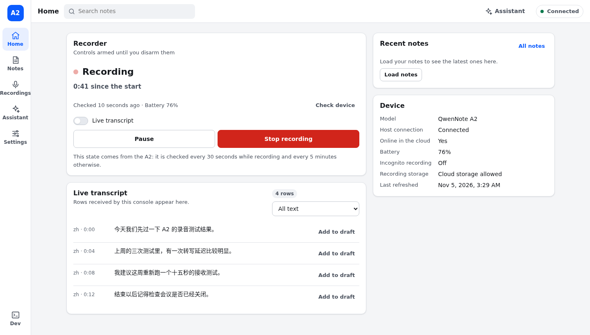
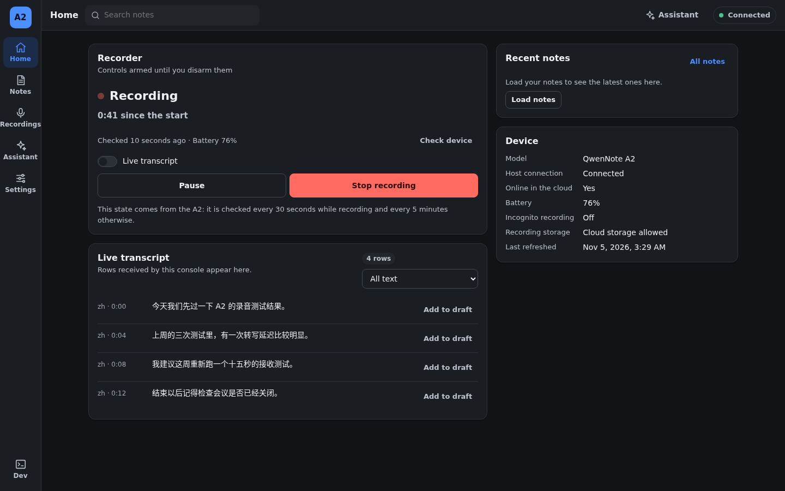
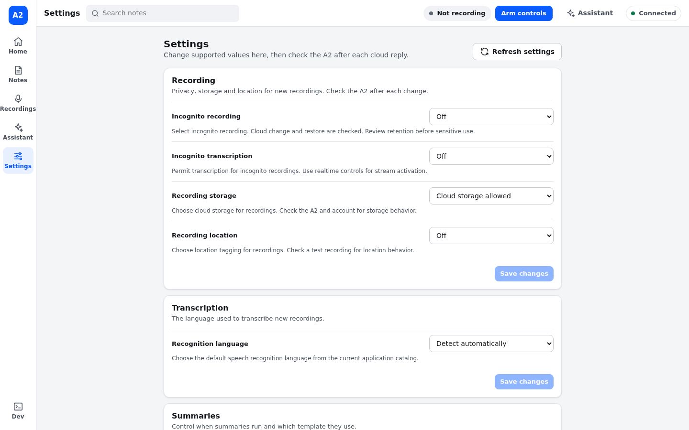
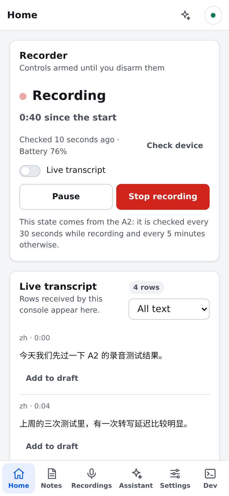

<div align="center">

# QwenNote A2 Console

**Your QwenNote A2 recordings, notes and device, from a console on your own machine.**

[](LICENSE) [](artifacts/standalone-session/DEPLOYMENT.md) [](https://qwennote-a2-console-demo.pages.dev/) [](#disclaimer)

[**Live demo**](https://qwennote-a2-console-demo.pages.dev/) · [Capabilities](docs/capabilities.md) · [Official MCP](docs/mcp.md) · [Install](artifacts/standalone-session/DEPLOYMENT.md) · [API](docs/host-api.md)

<a href="https://qwennote-a2-console-demo.pages.dev/?scenario=recording"></a>

<sub>Invented demo data. Click the picture to try the read-only demo in your browser.</sub>

</div>

<a id="disclaimer"></a>

> [!WARNING]
> **Unofficial project.** It is not affiliated with or endorsed by QwenNote, DingTalk or Alibaba, and product names belong to their owners. Use it only with **your own account and your own device**. It may conflict with the vendor's terms of service, and the vendor can change or block its interfaces at any time. There is no warranty.

## ✨ What you get

| Area | What it does |
| --- | --- |
| 🎙️ **Recorder** | Start, pause and stop the A2; see its real state, read back from the device instead of the last command sent; live transcript while you record; optionally download the original WAV automatically after Stop |
| 📝 **Notes** | Summaries and transcripts with speakers and times; edit and regenerate summaries; find and replace; tags, favorites and sharing; translation; export as TXT, Markdown, DOCX, PDF or SRT |
| 🗂️ **Recordings and memos** | Save any recording's original audio (WAV), recycle bin, groups and markers; voice memos |
| 🤖 **Assistant** | Ask about a note or anything else, with the built-in assistant or your own OpenAI-compatible provider |
| ⚙️ **Settings** | Recording, transcription, summary and alert settings, device name, quotas and 4G usage, each with a restore journal |
| 📄 **Official MCP** | QwenNote's OAuth/MCP document service: 14 read tools, plus 6 write tools on a separate opt-in grant |
| 🛡️ **Safety** | Device writes need armed controls; delete and unbind sit behind a switch and a typed word; ambiguous writes are never retried |
| 🌐 **Everywhere** | English and Simplified Chinese, light and dark, desktop and phone |

Each function, and whether it has been checked on a real A2: **[docs/capabilities.md](docs/capabilities.md)**.

<table>
  <tr>
    <td width="44%"></td>
    <td width="44%"></td>
    <td width="12%"></td>
  </tr>
  <tr>
    <td align="center"><sub>Dark mode</sub></td>
    <td align="center"><sub>Settings</sub></td>
    <td align="center"><sub>Phone</sub></td>
  </tr>
</table>

## 🚀 Quick start

**Just looking?** Open the [live demo](https://qwennote-a2-console-demo.pages.dev/), or run it locally with invented data and no account:

```sh
git clone https://github.com/HallucinatedCat/qwennote-a2-console.git
cd qwennote-a2-console
python3 tools/ui_preview.py          # then open http://127.0.0.1:18781/
```

**With your own A2** (Linux or macOS, Python 3.11+):

```sh
cd artifacts/standalone-session
python3 -m venv .venv
.venv/bin/pip install -r requirements.txt -r requirements-rtc.txt
.venv/bin/python import_session.py --source /path/to/native-session.json
.venv/bin/python web_backend.py --mcp-root ../mcp-reader
```

Then open **http://127.0.0.1:18780/**.

> [!IMPORTANT]
> The session file is yours to provide: this project ships no tool for extracting credentials from the vendor app. [docs/credentials.md](docs/credentials.md) lists exactly which values the backend needs. The document features need no file: they use QwenNote's own OAuth login, which you start from **Settings**.

Running it as a service, a custom assistant provider, a replacement UI: [DEPLOYMENT.md](artifacts/standalone-session/DEPLOYMENT.md).

## 🔌 Official MCP endpoints

| Item | Value |
| --- | --- |
| MCP server | `https://minutes.qwennote.cn/mcp`, streamable HTTP |
| OAuth issuer | `https://minutes.qwennote.cn` · [server metadata](https://minutes.qwennote.cn/.well-known/oauth-authorization-server) · [resource metadata](https://minutes.qwennote.cn/.well-known/oauth-protected-resource/mcp) |
| Scopes | `qwennote:read`, and `qwennote:write` (opt-in) |
| Flow | Authorization code with PKCE S256, dynamic client registration, refresh tokens |

Tools, arguments and related official documents: **[docs/mcp.md](docs/mcp.md)**.

## 🔐 Security

- Listens on **127.0.0.1 only**. Anyone who can reach that port controls your recorder, so don't run it on a shared host. For remote use, forward the port over SSH.
- Credentials stay in `.private/` (0700 directory, 0600 files) and never reach the browser. `.gitignore` excludes that folder.
- An HttpOnly SameSite=Strict cookie, a CSRF token, Host and Origin checks, and a fresh CSP nonce on every page load.
- Found a vulnerability? Please use GitHub's **Report a vulnerability** instead of a public issue.

## 📚 Documentation

| Document | Contents |
| --- | --- |
| [Capabilities](docs/capabilities.md) | Every function: working, needs a check, or not supported |
| [Credentials](docs/credentials.md) | The two credential sets, the session file format, importing |
| [Official MCP](docs/mcp.md) | Endpoints, OAuth, the 20 tools, official and related documents |
| [Host API](docs/host-api.md) | The backend's own HTTP routes, guards, cache and recovery rules |
| [Deployment](artifacts/standalone-session/DEPLOYMENT.md) | Installing, running, systemd, tests |
| [Frontend guide](artifacts/standalone-session/FRONTEND.md) · [Frontend API](artifacts/standalone-session/FRONTEND_API.md) | Replacing or extending the web UI |
| [MCP reader](artifacts/mcp-reader/README.md) | Command-line client for the document service |

<details>
<summary><b>Project layout</b></summary>

| Path | What it is |
| --- | --- |
| [`artifacts/standalone-session/`](artifacts/standalone-session/README.md) | Backend (`web_backend.py`), web UI (`web.html`, `i18n/`), protocol modules and tests |
| [`artifacts/mcp-reader/`](artifacts/mcp-reader/README.md) | OAuth/MCP command-line client |
| [`docs/`](docs/) | User documentation |
| [`tools/ui_preview.py`](tools/ui_preview.py) | The UI with invented data and no vendor connection |
| [`tools/build_demo.py`](tools/build_demo.py) | Builds the static read-only demo (Pyodide runs the preview in the browser) |
| [`tools/rtc_probe.py`](tools/rtc_probe.py) | Command-line check of the live-transcript session |
| [`tools/web-checks/`](tools/web-checks/) | Static checks for `web.html` and the translation catalogs |
| [`tools/a2-ble/`](tools/a2-ble/README.md) | Experimental, paused Bluetooth client for Windows |

</details>

<details>
<summary><b>Development and tests</b></summary>

From the repository root, after installing both requirement files into `artifacts/standalone-session/.venv`:

```sh
artifacts/standalone-session/.venv/bin/python -m unittest discover -s artifacts/standalone-session -q
PYTHONPATH=artifacts/standalone-session artifacts/standalone-session/.venv/bin/python -m unittest discover -s tools -q
artifacts/standalone-session/.venv/bin/python -m unittest discover -s artifacts/mcp-reader -q
python3 -m unittest discover -s tools/a2-ble -q
node tools/web-checks/check-web-ui.js && node tools/web-checks/test-quota-format.js
```

Tests use invented data and local loopback servers only; they never contact the vendor or a device. To rebuild the demo: `python3 tools/build_demo.py`, then serve `dist/demo/`.

</details>

## Contributing

Scope is deliberately narrow. Open an issue through the [bug or feature form](https://github.com/HallucinatedCat/qwennote-a2-console/issues/new/choose) first; pull requests must close an accepted issue and follow the template. Read [CONTRIBUTING.md](CONTRIBUTING.md) before you start.

## License

[GNU General Public License v3.0](LICENSE).
